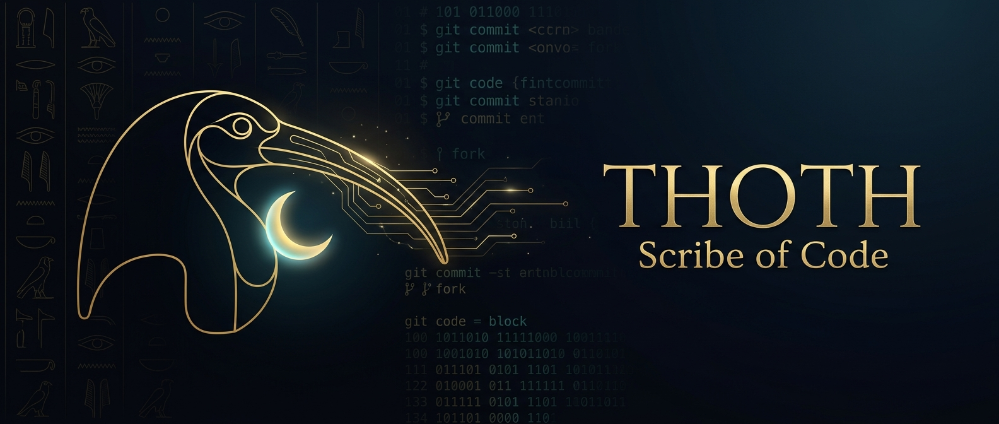

<i>“I am Thoth, the perfect scribe, whose hands are pure.” — <b>The Book of the Dead</b></i> 
<i>“我是托特，完美的书记官，双手洁净无瑕。” ——《亡灵书》</i>

---

### 🌙 Who Am I · 关于我

> In Egyptian myth, **Thoth** is the ibis-headed god of wisdom and writing — the scribe who records everything and the keeper of the moon.
> I borrow his name for a simpler craft: **collecting good tools, writing good configs, and keeping them in order.**
>
> 埃及神话中，**托特**是朱鹭首的智慧与文字之神——众神的书记官，月亮的守护者。
> 我借他的名字，做一件更朴素的事：**收集好用的工具，写好每一份配置，并让它们井然有序。**

<table>
  <tr>
    <td width="50%" valign="top">

**🪶 The Scribe · 书记官**

- 💻 Daily driver: **macOS**, terminal-first 主力 macOS，终端优先
- 🤖 Working alongside **AI coding agents** 与 AI 编程助手协作：pi · Claude Code · Codex
- 📝 Configs are scrolls — versioned, documented, reproducible 配置即卷轴：版本化、有注释、可复现

</td>
    <td width="50%" valign="top">

**🧭 The Explorer · 探索者**

- 🌐 Proxy cores & clients: sing-box · mihomo · Xray 网络代理内核与客户端
- 📡 Home network & OpenWrt routers 家庭网络与软路由
- ⌨️ **Rime** input method & typography Rime 输入法与中文字体
- 📺 Home media: Jellyfin · Emby · IPTV 家庭影音

</td>
  </tr>
</table>

---

### 🏺 Arsenal · 兵器谱

**Platform · 平台** 

**AI Companions · AI 伙伴** 

**Toolchain · 工具链** 

---

### 📜 The Library of Scrolls · 卷轴书库

> A curated collection of the tools I trust, sorted like a scribe's archive. 
> 我信赖的工具，按书记官的方式分卷收藏。

| Scroll · 卷轴 | Contents · 收录 | Count |
|:--|:--|:--:|
| 🤖 [AI 编程 · AI Coding](https://github.com/stars/wst4288/lists/ai-%E7%BC%96%E7%A8%8B) | Coding agents, LLM clients · 编程智能体与大模型客户端 | 13 |
| 🌐 [代理与网络 · Proxy & Network](https://github.com/stars/wst4288/lists/%E4%BB%A3%E7%90%86%E4%B8%8E%E7%BD%91%E7%BB%9C) | Proxy cores, GUIs, rules · 代理内核、客户端与规则 | 19 |
| 🍎 [Mac 工具 · Mac Apps](https://github.com/stars/wst4288/lists/mac-%E5%B7%A5%E5%85%B7) | Small apps that make macOS better · 让 Mac 更好用的小工具 | 15 |
| ⌨️ [输入法与字体 · Input & Fonts](https://github.com/stars/wst4288/lists/%E8%BE%93%E5%85%A5%E6%B3%95%E4%B8%8E%E5%AD%97%E4%BD%93) | Rime schemas, Fcitx5, fonts · Rime 方案、小企鹅、字体 | 7 |
| 📺 [影音与电视 · Media & TV](https://github.com/stars/wst4288/lists/%E5%BD%B1%E9%9F%B3%E4%B8%8E%E7%94%B5%E8%A7%86) | Music, IPTV, media clients · 音乐、直播源、影音客户端 | 9 |
| 📡 [路由器 · Routers](https://github.com/stars/wst4288/lists/%E8%B7%AF%E7%94%B1%E5%99%A8) | OpenWrt & router firmware · 软路由与固件 | 5 |
| 🧰 [其他实用 · Misc](https://github.com/stars/wst4288/lists/%E5%85%B6%E4%BB%96%E5%AE%9E%E7%94%A8) | Browser tweaks, scripts, reading · 浏览器、脚本与好文 | 6 |

---

### 🔭 Current Quest · 当前修行

- [x] Tidy up the archive — pruned old forks & stale stars · 整理旧档，清理过时的 fork 与收藏
- [x] Organize stars into scrolls · 收藏分卷归档
- [ ] Back up dotfiles & agent configs into versioned scrolls · 把 dotfiles 与 AI 助手配置纳入版本管理
- [ ] Build a personal toolkit, one script at a time · 一个脚本一个脚本地打造个人工具箱

---

𓅞 &nbsp; <i>Measure twice, configure once.</i> · <i>三思而后配。</i> &nbsp; 🌙

 

